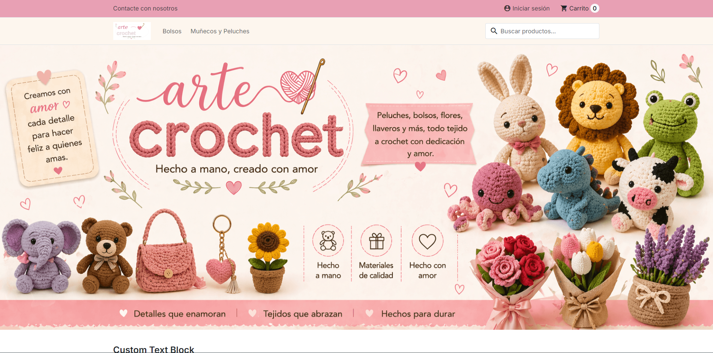

# Arte y Crochet 🧶

Tienda online de productos de crochet hechos a mano, construida con **PrestaShop** y desplegada con **Docker**.



## Qué he desarrollado

- **Child theme de Hummingbird** (`themes/child_hummingbird/`): paleta de colores propia en `custom.css` y plantillas sobrescritas para el bloque de contacto y el slider, sin tocar el tema padre.
- **Módulo propio `monitoringimage`** (`modules/monitoringimage/`): añade la foto y el stock de cada producto en *Catálogo → Monitorización* del panel de administración, usando un hook `action` para modificar el listado.
- **Entorno con Docker Compose**: PrestaShop, MySQL y phpMyAdmin, con los secretos en un `.env` fuera de Git.
- **Bind mounts** para versionar solo el código propio: el núcleo de PrestaShop vive en un volumen y el tema y el módulo se montan desde el repositorio.

## Stack

PrestaShop 9.1.0 · Hummingbird 2.0.0 · PHP · Smarty · CSS · MySQL 5.7 · Docker Compose

## Puesta en marcha

Requisitos: Docker y Docker Compose.

```bash
git clone git@github.com:Gerpaes/Arte-y-Crochet.git
cd Arte-y-Crochet
cp .env.example .env          # y rellena las contraseñas

# Recursos externos que el compose espera que existan
docker network create proxy
docker volume create prestashop_html_data
docker volume create prestashop_mysql_data

docker compose up -d
```

La tienda queda en `http://localhost:8085` y phpMyAdmin en `http://localhost:8081`. La primera vez, PrestaShop arranca el asistente de instalación (`PS_INSTALL_AUTO=0`).

## Estructura

```
├── docker-compose.yml
├── .env.example
├── CLAUDE.md                    # reglas del proyecto para Claude Code
├── docs/                        # capturas
├── themes/child_hummingbird/    # child theme (bind mount)
└── modules/monitoringimage/     # módulo propio (bind mount)
```

## Estado

🚧 En desarrollo. Próximos pasos:

- Fijar la versión de la imagen de PrestaShop
- Configurar pagos, envíos y textos legales
- Sustituir los textos de ejemplo de la portada